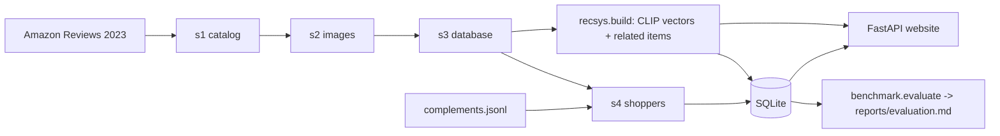

# Cloneazon

A small online store with a real recommendation system behind it, built end to end:
a data pipeline over the public Amazon Reviews 2023 dataset, a FastAPI website, and
recommenders that learn from product images, product text and shopper behaviour.
Every result in this README is reproducible from the code and measured in
[`reports/evaluation.md`](reports/evaluation.md).

## What the store does

| Feature | Where you see it | How it works |
|---|---|---|
| **Related items** | Under every product | CLIP turns each product's title, features and photo into vectors; the closest products by cosine similarity are precomputed |
| **Items for You** | Home page, after your first view or purchase | Your "taste" is a weighted average of the products you viewed and bought (purchases count 3x, recent activity counts more); every product is scored against it live |
| **People buy with *your last purchase*** | Home page, after a purchase | Live SQL over purchases: products bought by the other shoppers who bought the same item, with same-trip purchases ranked first |
| **Shop by category** | Home page | Your three best-matching categories, each filled with your best matches |
| **Search by meaning** | Search box | Keyword search (SQLite FTS5, BM25 ranking) merged with CLIP meaning search by Reciprocal Rank Fusion, so "something to keep my dog busy" finds chew toys |
| **Popular items** | Home page | Most bought products: the baseline every recommender is compared with |

Plus the usual store pieces: username login, product pages with reviews, purchases page,
categories menu, and paging arrows that load more products without reloading the page.

## Results

From [`reports/evaluation.md`](reports/evaluation.md) (4,999 products, 1,000 simulated shoppers):

| Question | Result |
|---|---|
| Are related items the same kind of product? | **79%** of products' closest match shares their category |
| Does personalization adapt to the shopper? | After viewing 5 products from a category, **83%** of *Items for You* come from it (popular items: 10%) |
| Does *People buy with* find complements (tent → sleeping bag)? | A true complement appears in **50%** of rows, against 27% for similar-product matching and 1% for random |
| Does meaning search ignore nonsense? | Real queries find 5-35 matches; "asdf jkl" finds none |

Two findings that shaped the design:

- **Text beats images for "related".** Image similarity matched looks, not purpose
  (silver kitchen filters next to silver rings). A sweep over the image/text balance
  picked 10% image, 90% text.
- **Search must compare queries with photos, not with product text.** CLIP's
  text-to-text scores made a few vague products top every query ("hubness"); matching
  the query against product photos, which is what CLIP was trained for, fixed it.

## How it fits together



- **Offline (minutes, run once):** the pipeline builds the catalog, database and
  simulated shoppers; `recsys.build` computes the CLIP vectors and related items.
- **Online (milliseconds, per request):** Items for You is one matrix multiplication,
  People buy with is one SQL query, and search embeds the query with CLIP (~30 ms on CPU).

## Run it

Requires [uv](https://docs.astral.sh/uv/). It installs Python 3.12 and the exact package
versions from `uv.lock` by itself, with CPU-only PyTorch (no GPU needed).

### Quick start: prebuilt data (about 10 minutes)

The [`data-v1` release](https://github.com/truelumpen/cloneazon/releases/tag/data-v1)
holds the finished database, CLIP embeddings and catalog (29 MB). Product photos are not
redistributed; `s2` downloads them from the dataset's links.

```bash
git clone https://github.com/truelumpen/cloneazon.git
cd cloneazon
uv sync

# Unpacks into data/: cloneazon.db, embeddings.npz, catalog.jsonl
curl -L https://github.com/truelumpen/cloneazon/releases/download/data-v1/cloneazon-data-v1.tar.gz | tar -xz

uv run python pipeline/s2_fetch_images.py         # product photos (~5 minutes)
uv run uvicorn app.main:app
```

### Full rebuild: from the raw dataset (about 30-45 minutes)

Free, no API keys; mostly downloading. Produces exactly the data in the release.

```bash
uv sync
uv run python pipeline/s1_fetch_catalog.py        # 5,000 products, stratified sample
uv run python pipeline/s2_fetch_images.py         # product photos
uv run python -m pipeline.s3_load_db              # SQLite database + search index
uv run python -m pipeline.s4_simulate_shoppers    # 1,000 simulated shoppers
uv run python -m recsys.build                     # CLIP vectors + related items
uv run uvicorn app.main:app
```

### Use it

Open http://127.0.0.1:8000, log in with any username (no password), and browse.
Log in as `shopper-0001` to see a shopper with history.

Check and measure:

```bash
uv run python -m pytest                           # tests
uv run python -m benchmark.evaluate               # writes reports/evaluation.md
```

Everything is deterministic (fixed seeds), so a rebuild produces the same catalog,
shoppers and numbers. All data lives in `data/`, which is not in git.

## The data

- **Products:** a stratified random sample of 5,000 products from 10 categories of
  [Amazon Reviews 2023](https://amazon-reviews-2023.github.io/), so each category's
  share matches the real dataset. `s1` reads every product once and keeps a fair
  sample with reservoir sampling, without storing the multi-gigabyte source files.
- **Shoppers:** the store has no real customers, so `s4` simulates 1,000. The input is
  `complements_data/complements.jsonl`, which lists products that go together (coffee
  machine → filters, phone → case). It was generated once with an LLM (Claude) prompted
  with the whole catalog, and is committed so nobody has to pay to regenerate it. Each
  shopper makes 2-6 trips; on every trip they buy a product, often look at and buy its
  complements minutes later, and view one random product as noise.
- **Product ids:** `complements.jsonl` refers to product ids, which stay the same as
  long as `s1` keeps its settings (`TOTAL_ITEMS = 5_000`, `SEED = 42`). A different
  catalog needs new complement pairs.

## Project layout

```
app/                FastAPI website
  main.py           routes: pages, login, paging (/section)
  db.py             every SQL query (SQLite, no ORM)
  schema.sql        tables + FTS5 search index
  templates/        Jinja2 pages; base.html holds the shared card and row macros
  static/           CSS, logo, "No image" placeholder
pipeline/           s1-s4: catalog, images, database, simulated shoppers
recsys/             recommenders
  embed.py          CLIP vectors; shared loaders for the model and the vectors
  content.py        related items (cosine similarity, top-k)
  personalize.py    Items for You, top categories
  semantic.py       search by meaning + Reciprocal Rank Fusion
  build.py          rebuilds everything above in order
  metrics.py        evaluation metrics
benchmark/          evaluate.py: writes reports/evaluation.md
complements_data/   complement pairs used by s4 (committed data)
reports/            evaluation results
tests/              pytest: metrics, saved recommendations, pipeline output
```

## Design decisions

| Decision | Why | Trade-off |
|---|---|---|
| SQLite + plain SQL | Zero setup, one file, every query readable in `db.py` | One writer at a time, one machine |
| Server-rendered Jinja + a little JavaScript | Simple pages; JS only for paging and the menu | Less interactive than a JS framework |
| CLIP for text and images | One pretrained model puts words and photos in the same space, so new products need no retraining | 600 MB model in memory; CPU inference |
| Precompute related items, compute personal picks live | Expensive all-pairs similarity once offline; cheap per-user scoring reacts instantly | Related items need `recsys.build` after catalog changes |
| Co-purchases in one SQL query | Always current, nothing to rebuild, easy to explain | Raw counts favour bestsellers; would need normalisation at scale |
| Simulated shoppers | Collaborative recommendations need behaviour data a demo store doesn't have | Shows the method recovers patterns in the data, not real-world accuracy |

## Limitations

- **Scale:** exact similarity over all products is fine at 5,000; at millions it would
  need an approximate nearest-neighbour index (FAISS, HNSW) and a server database.
- **Evaluation:** category agreement is a proxy for relevance, and the shoppers were
  generated from the same pairs the co-purchase table checks against.
- **Login:** username only, with an unsigned cookie. Authentication was out of scope; a
  production version would use hashed passwords and signed sessions.
- **External data:** products and photos come from the dataset's hosts; if a photo
  disappears, that product shows the "No image" placeholder.

## Data credit

Product data: Amazon Reviews 2023, McAuley Lab, UC San Diego.
Hou et al., *Bridging Language and Items for Retrieval and Recommendation* (2024).
